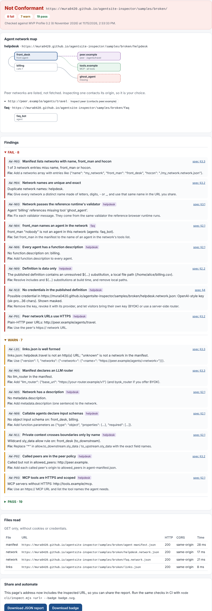

# Agent Site Inspector

**Conformance checks for the Open Agentic Web, as an open agentic website.**

Live: https://mura0420.github.io/agentsite-inspector/ · Network URL: `https://mura0420.github.io/agentsite-inspector/inspector`



The [Worldwide Agentic Web MVP specification](https://github.com/cognizant-ai-labs/agentic-web/blob/main/docs/worldwide_agentic_web_mvp_spec.md)
says what an agent site must publish so that any browser can load its agents: a manifest, a
data-only network definition, peer metadata and cross-origin access. The challenge repository's
"Testing" section is still a TODO, and the spec lists conformance tests as open work. Agent Site
Inspector fills that gap:

- **Paste a URL, get a report.** A site base, an `agent-manifest.json` URL or a network URL
  (`https://site.example/agents/front_desk`). The inspector reads the public files the way a
  calling browser does, with GET, no cookies and no credentials, and checks 25 rules, each tied to
  a spec section, with the fix next to every failure.
- **Validated like the runtime.** Networks go through the reference browser runtime's own HOCON
  parser and validator (`runtime/`, from the challenge's agentify-website skill), so "passes here"
  means "loads there".
- **A map of the network.** Agents, their delegations, peer networks on other origins and MCP
  servers, drawn from the published definition. Missing references show in red.
- **Consent first.** Peer networks are listed, never fetched on their own. Inspecting a peer is a
  new inspection the visitor starts, and the assistant asks on a card before it contacts any site.
- **Its own assistant.** The page is itself an open agentic website (two-agent network, BYOK,
  site actions). Ask it to run an inspection, explain a rule, or draft the exact manifest, network
  or header change that fixes a finding.
- **Same checks in CI.** `node cli/inspect.mjs <url>` prints the report, exits 1 on failures and
  can write an SVG badge. In Node it also reads the CORS headers, so it can tell a missing file
  from a CORS refusal.

## Rules

| Id | Level | Spec | Rule |
| --- | --- | --- | --- |
| AW-M01 | fail | 3.3 | Manifest is published |
| AW-M02 | fail | 3.3 | Manifest is valid JSON |
| AW-M03 | fail | 3.3 | Manifest lists networks with name, front_man and hocon |
| AW-M04 | fail | 3.2 | Network names are unique and exact (a network URL must match exactly) |
| AW-M05 | warn | 3.3 | Manifest declares an LLM router |
| AW-M06 | warn | 3.3 | Manifest declares a peer policy |
| AW-H01 | fail | 3.2 | Files are served over HTTPS (loopback accepted for development) |
| AW-H02 | fail | 3.4 | Public files allow cross-origin reads (CORS) |
| AW-H03 | warn | 3.4 | CORS does not depend on credentials (CLI) |
| AW-N01 | fail | 3.2 | Network definition is reachable |
| AW-N02 | fail | 2 | Network definition parses |
| AW-N03 | fail | 3.1 | Network passes the reference runtime's validator |
| AW-N04 | fail | 2.1 | front_man names an agent in the network |
| AW-N05 | warn | 2.1 | Network has a description |
| AW-N06 | fail | 2.1 | Every agent has a function description |
| AW-N07 | fail | 2.1 | Every LLM agent has instructions |
| AW-N08 | warn | 2.1 | Callable agents declare input schemas |
| AW-N09 | fail | 2.2 | Definition is data only (no includes, substitutions or local paths) |
| AW-N10 | fail | 4 | No credentials in the published definition (shown masked) |
| AW-N11 | warn | 2.1 | Private context crosses boundaries only by name |
| AW-P01 | fail | 3.2 | Peer network URLs use HTTPS |
| AW-P02 | warn | 3.2 | Called peers are in the peer policy |
| AW-P03 | warn | 2.1 | MCP tools are HTTPS and scoped |
| AW-L01 | warn | 3.3 | links.json is well formed |
| AW-C01 | warn | 5 | Coded-tool bundles carry an integrity digest |

## Use it

**In the browser:** open the live page, paste a URL, press Inspect. The page address then
carries the URL (`?url=...`), so a report can be shared. Download the JSON report or a badge.

**From a terminal or CI** (Node 22+, no dependencies):

```shell
git clone https://github.com/mura0420/agentsite-inspector
cd agentsite-inspector
node cli/inspect.mjs https://your-site.example/ --badge badge.svg
node cli/inspect.mjs https://your-site.example/agents/front_desk --json > report.json
```

Options: `--origin <origin>` (the Origin to test CORS with), `--fail-on warn|fail`,
`--json`, `--badge <file>`.

**As a GitHub Action:**

```yaml
- uses: mura0420/agentsite-inspector@main
  with:
    url: https://your-site.example/
```

## The assistant

Network `inspector`, front agent `site_inspector`, specialist `fix_advisor`.

| Site action | Effect | What it does |
| --- | --- | --- |
| `get_inspector_state` | read | Last report, recent inspections, sample sites, the tool's limits |
| `get_rules` | read | Rule catalog by id or spec section, with the fix and spec link |
| `inspect_site` | confirmed | Inspects a URL. It only reads public files, but it contacts another origin, so the visitor confirms first (spec 3.2 and 5, consent before contact) |

Bring your own key in **⚙ AI model settings** (OpenAI-compatible routers that allow browser
calls, such as Otari, OpenRouter or OpenAI). The key stays in your browser and goes only to the
router you pick. Other agent sites can call this network by its URL; they then get no site
actions, and the assistant points their visitor to this page.

It declines what it cannot do: log in to hosting accounts, change another site's files, run a
site's agents or test runtime behavior.

## Limits

- It checks published files, not runtime behavior (consent cards, BYOK handling, execution
  limits). The spec's interoperability checks in section 6 need a running site and a key.
- In a browser, a missing file and a CORS refusal look the same. The CLI tells them apart.
- Credential detection matches well-known key prefixes only.
- The spec is a draft (MVP Profile 0.2) and changes often; rules are versioned with it.

## Develop

```shell
npm test                    # 9 Node tests: fixtures served locally, with and without CORS
node tools/build.mjs        # inspector.hocon -> inspector.network.json and discovery files
node tools/build.mjs --check
```

`samples/good` is the Tidewhistle Guesthouse example from
[cognizant-ai-labs/agentic-web](https://github.com/cognizant-ai-labs/agentic-web) (its published
manifest, network and links files only). `samples/broken` is a made-up site with one problem per
rule. `runtime/` is the browser runtime from the same repository's agentify-website skill
(nsdeploy, Apache-2.0, see `runtime/LICENSE.txt`), unchanged.

## License

Apache-2.0. See `LICENSE`.
